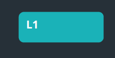

# Captura local do travamento — sem publicar o app

Preparado para a sessão habitual do DealSifter no Edge. Não usa F12, Console, código colado, portas de depuração ou outro login. Nenhuma extensão foi instalada automaticamente: este ambiente não dispõe de controle da interface do seu Edge.

## 1. Instalação inicial, uma única vez

Você autorizou a extensão temporária. O Edge exige estes cliques para carregá-la localmente:

1. No Edge, abra o menu **… → Extensões → Gerenciar extensões**.
2. Ative **Modo do desenvolvedor** e clique **Carregar sem compactação**.
3. Na escolha de pasta, selecione esta pasta **extension** (não a pasta local-capture):

   `C:\Users\Tarso\Desktop\DEALSIFTER\DealSifter_Match\qa\report-freeze\local-capture\extension`

4. No menu de extensões, fixe **DealSifter - Diagnostico local temporario** na barra do Edge.

A permissão de depuração é poderosa: o navegador pode exibir um aviso. O código limita o uso à aba de `https://dealsiftermatch.vercel.app`, após seu clique. Não coleta DOM, textos, formulários, cookies, armazenamento do app, cabeçalhos, respostas HTTP, imagens, screenshots ou mensagens de erro. Não aciona nenhum provedor nem gera relatórios sozinho. Não desligue configurações adicionais caso uma política do Edge impeça a instalação; informe o impedimento.

## 2. Capturar UMA ocorrência real

1. Abra o DealSifter normalmente e deixe o relatório pronto para gerar.
2. Dê dois cliques em **Iniciar-diagnostico.exe**, nesta pasta. Deixe a janela aberta: ela grava CPU/memória fora do navegador por três minutos.
3. Volte à aba do DealSifter e clique uma vez no ícone da extensão. Aguarde aparecer **REC** no ícone. O arquivo parcial será baixado automaticamente.
4. Gere **um** relatório L3. Não gere outros relatórios durante esta captura. Se o Edge disser que a página não responde, escolha **Aguardar**; não encerre o navegador.
5. A extensão encerra após identificar geração + liberação da interface, ou em três minutos. O ícone muda para **OK**. Para encerrar antes, clique novamente no ícone. O monitor externo também encerra sozinho em três minutos.

O monitor externo é um clique adicional necessário para a proteção contra bloqueio total; não há comunicação oculta com a extensão, serviço instalado, porta local nem registro de native messaging. A extensão sozinha inicia a captura de página/CPU com um clique, mas não substitui esse monitor externo em caso de falha de todo o navegador.

## 3. Arquivos produzidos automaticamente

- Na pasta de downloads configurada no Edge: **DealSifter-Diagnostico/captura-[número]-final.json**. Contém etapas emitidas pelo app, tarefas longas, atrasos do temporizador, recursos agregados e amostras CPU sanitizadas. **Não é o PDF do imóvel**.
- Na mesma pasta de downloads: **captura-[número]-parcial.json**, atualizado a cada 15 segundos pela extensão. Se não houver arquivo final, este preserva a última resposta disponível. A configuração habitual de perguntar onde salvar downloads pode abrir uma confirmação; não a alteramos.
- Nesta pasta, subpasta **resultados**: **edge-[número].jsonl**, atualizado a cada segundo. Continua gravando mesmo com a thread da página bloqueada. Use o arquivo da sua captura, não o arquivo de três segundos usado no autoteste.

Pode enviar o JSON final e o JSONL correspondentes. Se não houver final, envie o parcial e o JSONL. Não envie HAR, gravações brutas, cookies, PDFs ou screenshots do imóvel para esta análise.

## O que a captura pode concluir

- **Etapas PDF**: modelo/preparação interna, importação, desenho e montagem, conforme os eventos existentes do app. Outros eventos existentes permitem localizar o intervalo anterior e a liberação da interface quando emitidos naquele caminho.
- **Imagens, mapas e tradução**: contagens/tempos agregados de recursos concluídos após iniciar a captura. Não são tempos exatos de decodificação, canvas ou tradução em cache; tarefas síncronas exigem a amostragem CPU. Recursos em andamento no congelamento podem não aparecer.
- **Função bloqueante**: a amostragem CPU aponta funções conhecidas ou o arquivo público compilado e suas coordenadas linha/coluna. Nomes arbitrários são omitidos por privacidade. Em código minificado, pode ser necessário correlacionar as coordenadas com o bundle publicado; não promete nome original sem source map.
- **Bloqueio permanente**: o processo de extensão tenta recuperar o perfil CPU por oito segundos e salva o resumo mesmo sem resposta. Isso não garante uma pilha de função se o renderer nunca responder. O arquivo externo preserva CPU/memória de todos os processos Edge, mas não sabe qual aba/imóvel eles representam nem identifica JavaScript. Assim, uma captura real ainda pode ser inconclusiva; não fabricamos essa atribuição.
- **Efeito do diagnóstico**: profiling tem custo e pode alterar os tempos; amostragem configurada em 10 ms. Não habilitamos screenshots, heap snapshots, interceptação de rede, pausas/breakpoints ou throttling.

## Depois da captura

Remova a extensão em **Gerenciar extensões → Remover** e restaure o Modo do desenvolvedor ao estado anterior, se você o ativou apenas para isso. Feche o monitor externo. Nenhum serviço, tarefa agendada ou alteração permanente do aplicativo é instalado. Recarregar a aba também remove o coletor temporário da página.

## Validação técnica desta entrega

- Monitor externo compilado localmente com .NET Framework do Windows; autoteste de três segundos salvou quatro amostras e marcador de conclusão, JSONL válido, saída 0.
- Extensão validada em Chromium isolado: transporte Profiler real, coleta de tarefa longa, download automático de JSON sanitizado, exclusão de sentinel privado e desconexão da depuração ao concluir. O contexto de teste não usou o Edge autenticado.
- Não houve teste autenticado, diagnóstico definitivo, deploy, mudança de aplicação/design ou execução de suítes extensas. Somente novos arquivos de diagnóstico e um apontamento no relatório anterior.

Fontes de capacidades: [instalação local no Edge](https://learn.microsoft.com/en-us/microsoft-edge/extensions/getting-started/extension-sideloading) e [API debugger das extensões Chromium](https://developer.chrome.com/docs/extensions/reference/api/debugger).
